Based in Tunis, Tunisia

[LinkedIn](https://www.linkedin.com/in/lina-garci-7b6b18448/) &nbsp; / &nbsp; [HirfaTech](https://hirfatech.com)

---

## 01 / About me

I build web and mobile applications using **React, TypeScript, Flutter, Node.js and PostgreSQL**. My work spans responsive interfaces, backend APIs, database integration and e-commerce.

I enjoy solving practical problems and turning ideas into working products. I am open to **junior development roles** and **freelance collaborations**.

## 02 / Featured project

### HirfaTech
**A web and mobile marketplace for local artisan commerce.**

A platform connecting artisans, customers and suppliers through product catalogues, ordering workflows and role-based dashboards, with AI assistance and live commerce.

| Web | Mobile | Backend | Real-time |
| :--- | :--- | :--- | :--- |
| React · TypeScript | Flutter · Dart | Node.js · Express · PostgreSQL | Socket.io · WebRTC |

**[Explore the live website →](https://hirfatech.com)**

## 03 / Selected projects

<table>
<tr>
<td width="50%" valign="top">

### 🛍️ Showcase & E-commerce Websites
Responsive websites and Shopify storefronts tailored to client needs.

**Shopify · HTML · CSS · JavaScript**

</td>
<td width="50%" valign="top">

### 📈 Trading Simulation
A React interface with reusable components, state management and simulated buy/sell transactions.

**React · JavaScript · Firebase**

</td>
</tr>
<tr>
<td width="50%" valign="top">
